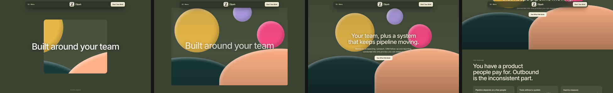
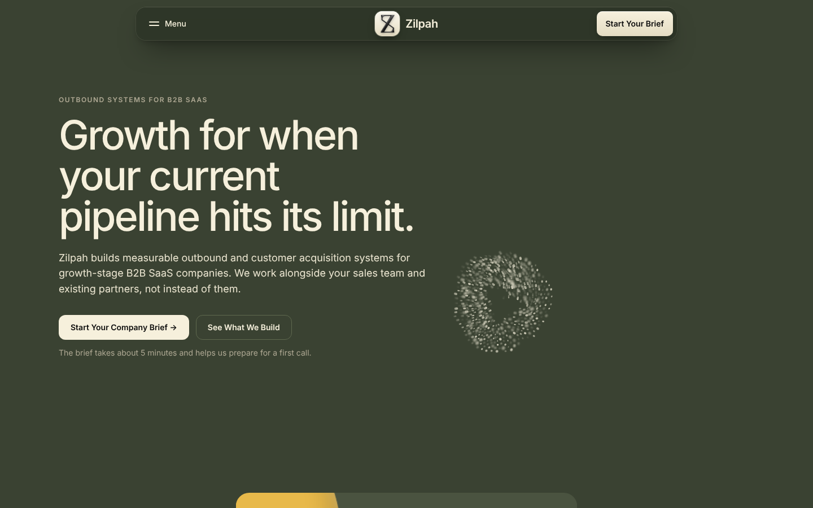
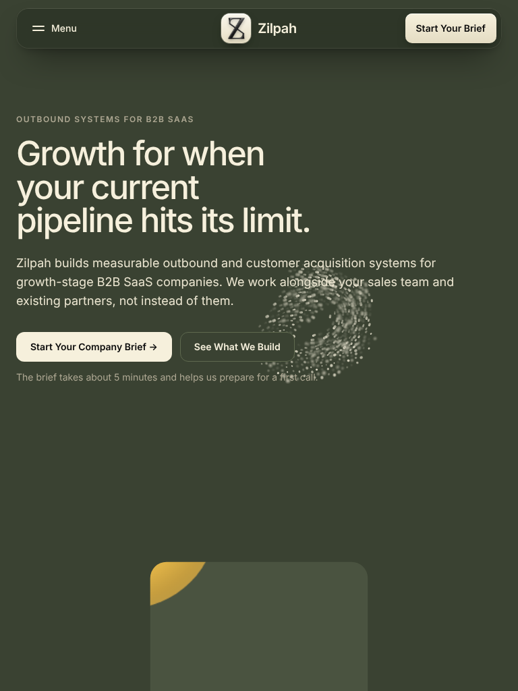
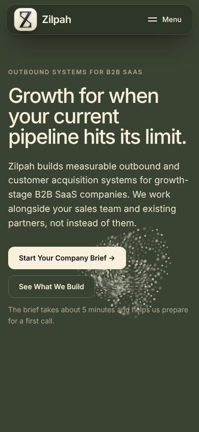
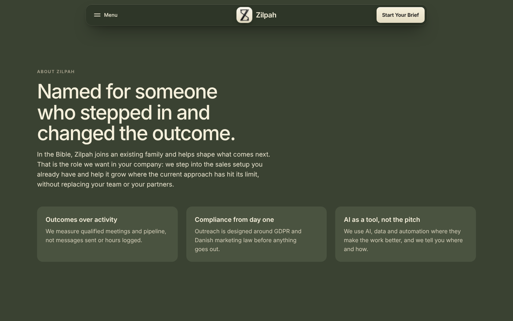
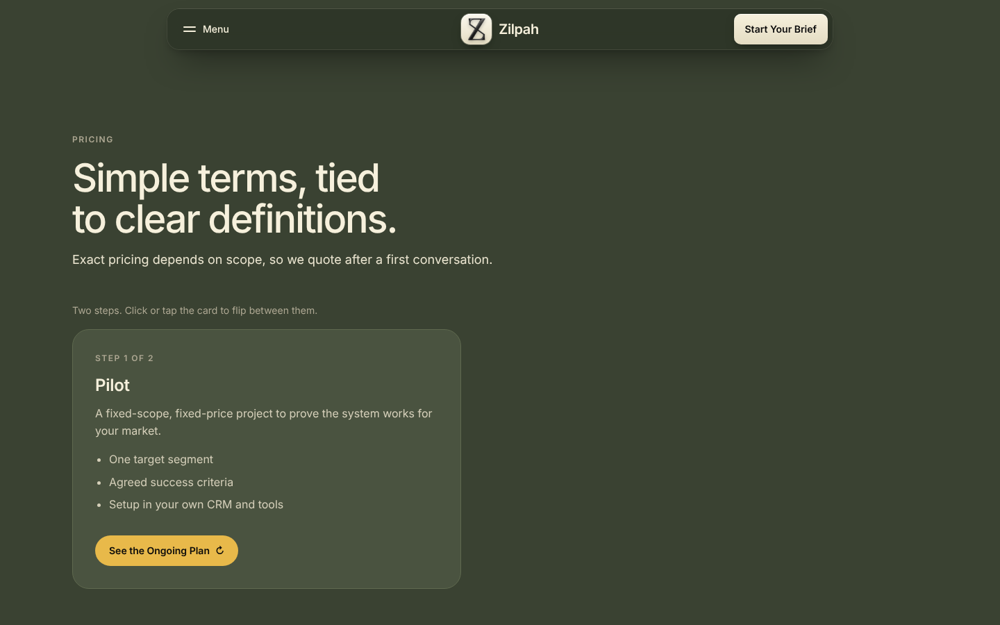
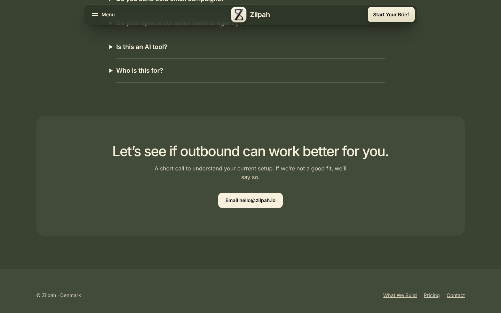
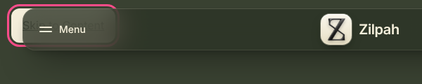

# Zilpah site audit

18 October 2026 · index.html and brief.html as they were before the fixes

**Update, same day:** everything under "Quick fixes" in the suggested order at the end is now done and live in the preview. The rest still needs your input.

**How I tested.** A headless browser at 1440×900, 1280×720, 1024×768, 768×1024 and 390×844, with and without reduced motion, plus a keyboard-only pass and an automated contrast check.

## The short version

1. **Visitors scroll 3.3 screens before the first real section.** The hero animation is 2.5 screens of abstract shapes with two short lines of text.
2. **Nothing shows who is behind Zilpah or what the work looks like.** No founder, no photos, no example deliverables. Established competitors show their product in almost every section; without clients yet, the people and the process are the proof.
3. **The company details Danish law asks for are missing.** No CVR, address or privacy policy, although the brief collects personal data.
4. **Pricing has no next step, and the closing CTA switches from the brief to email.**
5. **A handful of keyboard and contrast bugs**, each a one-line fix.

## Where it feels clunky

| # | What | Evidence | Suggested fix | Effort |
|---|---|---|---|---|
| 1 | Long scroll before content | "The problem" starts at 2,979px on desktop (3.3 screens) and 2,838px on a phone (3.4). The scroll-expand track alone is 2.55 screens. [Screenshot](img/scroll-strip.png) | Shorten the animation and the hold, and show something worth looking at in the frame, such as a diagram of the system. | Quick |
| 2 | Empty desktop hero | The text sits in the left half; the right half holds only the swarm ring, with a tall gap under the buttons. [Screenshot](img/fold-1440.png) | Give the right half a deliberate visual (the system diagram, or the swarm framed as an element). | Medium |
| 3 | Swarm covers text on tablets and phones | With no cursor, the swarm parks on top of the lead paragraph at 768px and the brief note at 390px. [Tablet](img/fold-768.png), [phone](img/fold-390.png) | On touch screens, park it in the empty space below the buttons, or turn it off there. | Quick |
| 4 | Sections all look alike | Each one is a small label, a big headline in the left half, an empty right half, then a row of cards. About reuses the Problem cards, so it reads like a repeat. [Screenshot](img/1440-about.png) | Give About its own layout: founder photo, short story, professional profile link. | Medium, needs you |
| 5 | Pricing is a dead end | No button in the section, the card fills under half the width, and the flip means the two plans can't be compared at a glance. [Screenshot](img/1440-pricing.png) | Keep the flip, and add "Get a Quote" (to the brief) plus a short "what happens next" note beside the card. | Quick |
| 6 | Closing CTA changes the ask | The whole page pushes the brief, but the last band only offers "Email hello@zilpah.io". [Screenshot](img/1440-contact.png) | Brief as the main button, email as the secondary one, later a booking link. | Quick |
| 7 | FAQ looks off-grid | A narrower centred column, markers hanging outside the dividers, and only 4 questions. | Align it with the other sections, use +/− icons, and add questions on pricing, tools, data and what you need from the client. | Quick |
| 8 | Thin footer | Only "© Zilpah · Denmark" and 3 links. | Section links, company details, privacy link, social profile. | Quick, then needs you |
| 9 | Desktop nav hides everything | Every section link needs a click on Menu first. Comparable sites show 4 to 5 top-level links. | Optional: two or three inline links on wide screens. A trade-off with the CardNav look, so your call. | Medium |
| 10 | Brief depends on the visitor's mail app | Submitting opens a mailto: link. On a work laptop with webmail and no mail app set up, nothing happens, and the Copy button is the only fallback. It is also 14 required fields over 3 to 4 screens. | A real form endpoint so answers arrive directly, and a few more optional fields. | Medium, needs you |

## Accessibility bugs (all quick)

| What | Evidence | Fix |
|---|---|---|
| Skip link hidden under the nav | At 1024px and below, the focused "Skip to Content" link sits under the menu bar. [Screenshot](img/skip-link-1024.png) | Raise it above the nav (z-index 40). |
| Focus hides under the sticky nav | Tabbing backwards puts the first two FAQ questions 0 to 32px from the top, behind the 72px nav. | `html { scroll-padding-top: 96px }` |
| Muted text just under AA | Labels, the brief note and the flip hint are 4.40:1 (AA needs 4.5:1). "Step 1 of 2" on the pricing card is 3.39:1. | `--muted: #bcb6a1` (5.16:1), and the body colour for the card tag (5.22:1). |
| Form errors are silent for screen readers | Errors show visually, but no field gets `aria-invalid` or `aria-describedby`. | Set both during validation. |
| Reduced motion still zooms | With reduced motion on, the hero frame still scales with scroll over the same long track. The swarm and menu already handle it correctly. | Show the expanded frame statically and shorten the track. |
| Small tap targets on phones | Menu card links are 26px tall, footer links 17px. | Touch areas of at least 44px. |

## What established competitors have that we don't

Nothing here should be invented. Where they rely on proof Zilpah doesn't have yet, the right column is the honest version.

| They have | Why it works | Zilpah version |
|---|---|---|
| Customer logos, testimonials with numbers | Instant trust | Not yet. Lead with the founder instead: name, photo, background, profile link. Add case studies once a pilot client agrees. |
| Product screenshots in nearly every section | Shows what you actually get | A diagram of the system (ICP, lists, outreach, CRM, handoff, reporting) and sample deliverables with dummy data, labelled as examples. |
| Two CTAs ("Get a demo", "Start free trial") and "No credit card required" | A light path and a committed path, plus a reassurance line | Keep the brief, add "Book a 20-minute call", and a line like "No commitment. We'll tell you if we're not a fit." |
| Security and compliance block (GDPR and security badges, a privacy center) | Removes a blocker for B2B buyers | "How we handle data": GDPR, Danish marketing law, DPA on request, no cold email. Only what is true. |
| Use cases by role or situation (for example as tabs) | Visitors recognise themselves quickly | Cards or tabs such as "Founder-led sales", "First SDR hire", "Agency not delivering". |
| Rich footer with legal pages and socials | Looks established and meets legal requirements | Privacy policy, company details, social profile. |
| Guides and resources | Search traffic and authority | Later: a guide to compliant B2B outbound in Denmark fits the positioning well. |
| Link previews | Links look right when shared on social and chat apps | `og:title`, `og:description`, `og:image`, canonical URL and Organization JSON-LD. None exist yet. |
| Public pricing | Fewer "what does it cost" calls | Optional "Pilots from DKK X" or a typical pilot length. Your call. |

## Legal checks

- **E-commerce Act § 7 (e-handelsloven):** name, physical address, email and CVR number (if registered) must be easy to find and permanently available. The site shows only the name and an email. The footer is the usual place. [Text of § 7](https://www.lovguiden.dk/loven/e-handelsloven/7)
- **GDPR Art. 13:** the brief collects name, email and company details, but there is no privacy notice. Add a privacy page and link it next to the consent checkbox.
- **Hosted web fonts:** Inter loaded from a third-party font service, which sends every visitor's IP address to that service. A German court ruled in 2022 that this breaches GDPR without consent. Self-hosting the font files removes the question.
- **Cold email:** the FAQ already handles this correctly.

## What already works

- The brief CTA is above the fold at every size tested, with no horizontal scrolling and no console errors.
- The skip link is the first Tab stop, focus rings are clear, and the brief jumps to the first missing field.
- The swarm stops drawing once it is scrolled away and under reduced motion; the menu respects reduced motion too.
- The copy is specific and makes no claims it can't back.

## Suggested order

1. **Quick fixes, no input needed:** shorter hero animation (static under reduced motion), swarm moved off the text on touch screens, pricing button and next-steps note, brief-first closing CTA, FAQ alignment and extra questions, fuller footer links, the accessibility table, link previews, self-hosted Inter.
2. **Needs your input:** CVR and address, founder name, photo and profile link, a booking link, pilot length or a starting price, a form endpoint, and a privacy page (I can draft it).
3. **Bigger additions:** the system diagram, sample deliverables, a use-case section, a data and compliance section, inline desktop nav links, a Danish version.

## Screenshots

**Scroll sequence**

**Desktop hero**

**Tablet hero**

**Phone hero**

**About**

**Pricing**

**FAQ, CTA and footer**

**Skip link**

